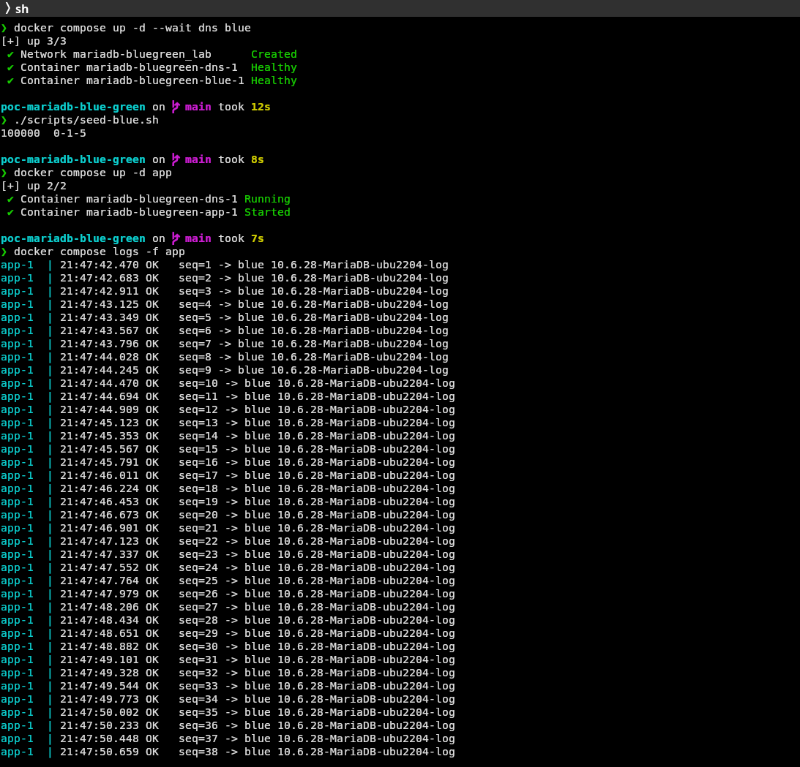
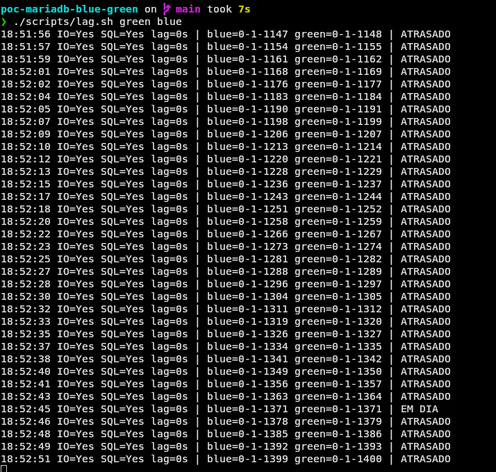
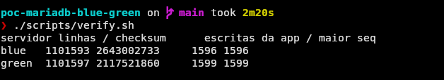
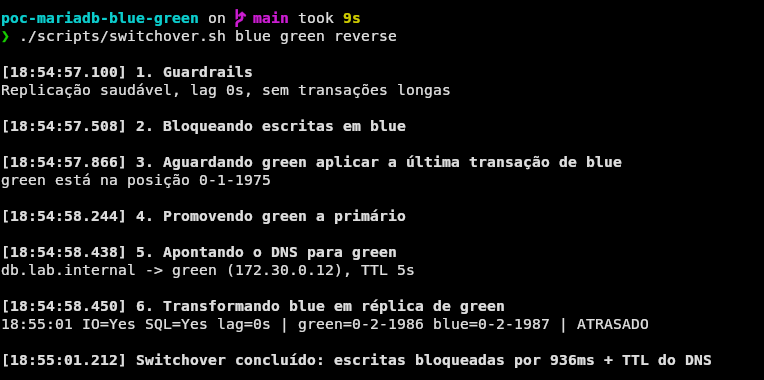
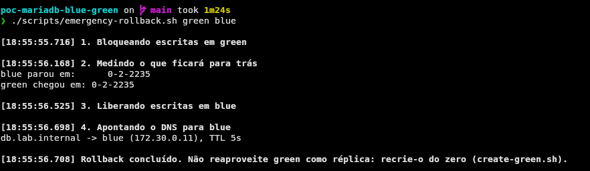
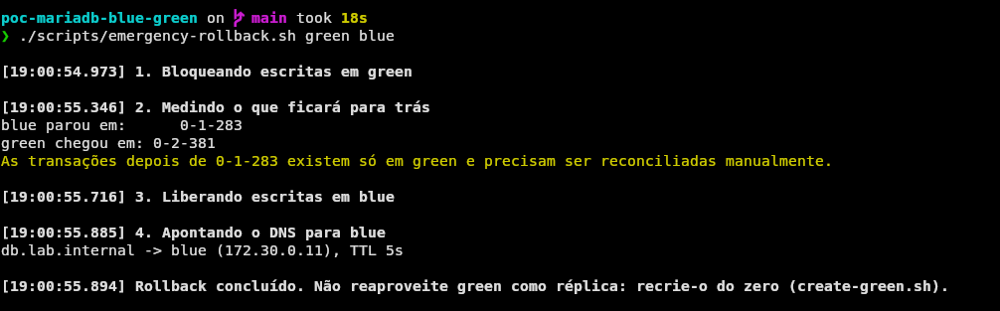
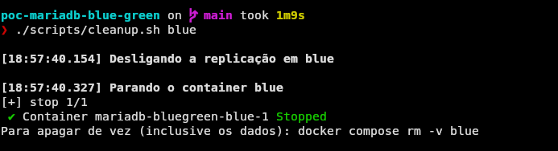

Atualizar o banco de dados costuma ser a parte mais tensa de qualquer manutenção. Trocar a versão do MariaDB "a quente" significa parar o serviço, rodar o upgrade, torcer para tudo subir e, se algo der errado, restaurar backup com o sistema fora do ar.

Neste artigo vou mostrar como fazer isso de outro jeito: com um **Blue/Green Deployment** só com servidores MariaDB, no mesmo espírito do que a AWS faz no [RDS Blue/Green Deployments](https://docs.aws.amazon.com/AmazonRDS/latest/UserGuide/blue-green-deployments-overview.html). A ideia é preparar um banco novo ao lado do atual, mantê-lo sincronizado por replicação e, na hora da troca, ficar só alguns segundos sem escrita.

Para ter um caso real, vamos sair do **MariaDB 10.6**, cujo suporte terminou em julho de 2026, para o **MariaDB 11.8**, a LTS atual (no momento do artigo). Tudo roda em containers, então você consegue reproduzir na sua máquina.

> O laboratório completo com todos os scripts do artigo estão no repositório [poc-mariadb-blue-green](https://github.com/reinaldocoelho/poc-mariadb-blue-green). Fique à vontade para clonar ou fazer fork.

## Antes de começarmos

Antes de começar, eu quero deixar algumas coisas pontuadas:

1. Este artigo foi escrito sim com o auxilio de uma LLM, como isso tem sido alvo de muitas criticas, prefiro deixar isso declarado aqui. Porém todos os passos foram testados e validados manualmente, garantindo que funcionam conforme descrito.
2. Para você reproduzir é necessário que tenha conhecimento no mínimo intermediário sobre Bancos de Dados e MariaDB. Se você é iniciante, recomendo estudar um pouco mais sobre esses tópicos antes de tentar seguir este artigo.

## O que é Blue/Green para banco de dados

Blue/Green é uma técnica muito comum para reduzir Downtime de atualizações em aplicações críticas. Para bancos de dados é a mesma coisa, como você atualiza a versão do banco ou uma estrutura sem interromper o serviço principal.

- **Blue** é o ambiente em produção, que as aplicações usam hoje.
- **Green** é o ambiente novo, já com a versão (ou estrutura) atualizada, recebendo uma cópia contínua dos dados do blue.

Quando o green está validado e em dia, fazemos o **switchover**: o green vira o banco principal e as aplicações passam a usá-lo. O processo que vamos seguir:

1. Temos um banco em uso, desatualizado (blue).
2. Subimos um banco novo, atualizado (green), recebendo replicação direta do blue, e acompanhamos o **lag** da replicação.
3. Garantimos que o green está completo e em dia.
4. As aplicações acessam o banco **por um nome DNS**, nunca pelo IP ou hostname do servidor.
5. No switchover, o green é promovido a principal e escolhemos o destino do blue: virar **réplica do green** ou ficar **parado e somente leitura**.
6. O DNS passa a apontar para o green.
7. Por fim, escolhemos entre **rollback** (voltar para o blue) ou **limpeza** (desligar o blue).

### E o que a AWS faz?

No RDS, o switchover bloqueia as escritas nos dois lados, espera o green alcançar o blue, troca os nomes dos endpoints e libera as escritas no green. Depois disso **a replicação entre os dois é encerrada**: o blue antigo é renomeado para `-old1` e fica somente leitura, mas não recebe mais nada do green.

Aqui vamos mostrar esse caminho e mais um: fazer o blue antigo **replicar a partir do green**, para permitir um rollback sem perda de dados. Cada caminho tem um risco diferente, e a escolha é discutida no passo 5.

## O laboratório

```text
                 db.lab.internal (TTL 5s)
                         │
   ┌─────┐   DNS    ┌────▼────┐
   │ app │ ───────▶ │ CoreDNS │
   └──┬──┘          └─────────┘
      │ escreve no IP que o DNS devolver
      ▼
 ┌──────────────┐  replicação GTID  ┌───────────────┐
 │ blue (10.6)  │ ────────────────▶ │ green (11.8)  │
 │ primário     │                   │ read_only=ON  │
 └──────────────┘                   └───────────────┘
```

São quatro containers:

- **dns**: um [CoreDNS](https://coredns.io/) que resolve `db.lab.internal` com TTL de 5 segundos. Trocar o registro é só reescrever um arquivo `hosts`.
- **blue**: MariaDB 10.6, o "banco de produção".
- **green**: MariaDB 11.8, que só subimos no passo 2.
- **app**: simula a aplicação, como se estivesse em outra máquina. É um Alpine Linux com apenas o cliente `mariadb` instalado, **sem nenhum servidor de banco**, rodando um loop em bash que grava uma linha a cada 200 ms usando apenas o nome `db.lab.internal`. Ele registra em qual servidor gravou e, se a escrita falhar, tenta de novo a mesma sequência. No fim, conferimos se não ficou nenhum buraco.

A imagem do `app` é construída por um Dockerfile mínimo:

```dockerfile
# Cliente da "aplicação": só bash, o cliente mariadb e o date do coreutils (o do BusyBox não tem %N)
FROM alpine:3.22
RUN apk add --no-cache bash coreutils mariadb-client
```

```yaml
# ./code/compose.yaml

name: mariadb-bluegreen

x-mariadb: &mariadb
  environment:
    MARIADB_ROOT_PASSWORD: root
    MARIADB_DATABASE: lab
    MARIADB_USER: app
    MARIADB_PASSWORD: app
  healthcheck:
    test: ['CMD', 'healthcheck.sh', '--connect', '--innodb_initialized']
    interval: 2s
    retries: 30

services:
  # DNS interno: resolve db.lab.internal para o primário atual (TTL de 5s)
  dns:
    image: coredns/coredns:1.12.1
    command: ['-conf', '/etc/coredns/Corefile']
    volumes:
      - ./dns:/etc/coredns:ro
    networks:
      lab:
        ipv4_address: 172.30.0.10

  # Banco em produção, desatualizado
  blue:
    <<: *mariadb
    image: mariadb:10.6
    hostname: blue
    volumes:
      - ./conf/blue.cnf:/etc/mysql/conf.d/bluegreen.cnf:ro
      - ./initdb:/docker-entrypoint-initdb.d:ro
    networks:
      lab:
        ipv4_address: 172.30.0.11

  # Banco novo, atualizado (só é iniciado no passo 2)
  green:
    <<: *mariadb
    image: mariadb:11.8
    hostname: green
    volumes:
      - ./conf/green.cnf:/etc/mysql/conf.d/bluegreen.cnf:ro
      - ./initdb:/docker-entrypoint-initdb.d:ro
    networks:
      lab:
        ipv4_address: 172.30.0.12

  # "Aplicação": um Linux mínimo só com o cliente MariaDB (nenhum servidor aqui),
  # gravando continuamente usando apenas o nome db.lab.internal
  app:
    build: ./app
    entrypoint: ['bash', '/scripts/app-writer.sh']
    dns: [172.30.0.10]
    volumes:
      - ./scripts:/scripts:ro
    depends_on: [dns]
    networks:
      lab:
        ipv4_address: 172.30.0.20

networks:
  lab:
    ipam:
      config:
        - subnet: 172.30.0.0/24
```

### Pré-requisitos de configuração

Esse processo depende de algumas configurações que é melhor deixar prontas **antes** de precisar delas. No blue:

```ini
[mariadb]
server_id            = 1
log_bin              = mariadb-bin
relay_log            = relay-bin
binlog_format        = ROW
log_slave_updates    = ON
gtid_strict_mode     = ON
character_set_server = utf8mb4
collation_server     = utf8mb4_general_ci
```

O green é igual, com `server_id = 2` e mais uma linha:

```ini
# Nasce como réplica: só a replicação (e usuários administrativos) podem gravar
read_only            = ON
```

O motivo de cada configuração:

- **`server_id` diferente** em cada servidor é obrigatório para replicação.
- **`log_bin` nos dois servidores**: o green precisa gerar binlog desde o início, porque depois da troca é dele que o blue vai replicar.
- **`log_slave_updates = ON`**: o green grava no próprio binlog o que recebe do blue. É isso que permite ao blue "continuar de onde parou" quando virar réplica.
- **`binlog_format = ROW`**: replica o valor final de cada linha, o modo mais seguro entre versões diferentes.
- **GTID com `gtid_strict_mode`**: com [GTID](https://mariadb.com/kb/en/gtid/), cada transação tem um identificador global (`dominio-servidor-sequencia`). Comparar posições vira comparar dois textos, e o servidor recusa histórico divergente em vez de corromper dados silenciosamente.
- **Charset e collation explícitos**: o 11.x mudou os padrões (`utf8mb4_uca1400_ai_ci`), que o 10.6 não conhece. Fixar o mesmo valor nos dois lados evita surpresas, principalmente no rollback.
- **`read_only = ON` no green**: impede que alguém grave nele por engano antes da hora. Usuários comuns (como o `app`) são bloqueados; a replicação continua funcionando.

O usuário de replicação é criado **nos dois servidores**, porque qualquer um deles pode virar primário:

```sql
-- ./code/initdb/01-replication-user.sql

-- Criado localmente nos dois servidores (sem ir para o binlog):
-- quem for primário precisa aceitar a conexão de replicação do outro.
SET SESSION sql_log_bin = 0;
CREATE USER 'repl'@'%' IDENTIFIED BY 'repl';
GRANT REPLICATION SLAVE, REPLICATION CLIENT ON *.* TO 'repl'@'%';

```

## Passo 1: o banco atual em uso

Suba o DNS e o blue, crie a carga inicial e ligue a aplicação:

```bash
git clone https://github.com/reinaldocoelho/poc-mariadb-blue-green.git
cd poc-mariadb-blue-green
docker compose up -d --wait dns blue
./scripts/seed-blue.sh
docker compose up -d app
docker compose logs -f app
```

Cada linha do log mostra uma escrita aceita e em qual servidor ela foi gravada:



## Passo 2: subindo o green com replicação

```bash
docker compose up -d --wait green
./scripts/create-green.sh
```

O script descarta qualquer replicação anterior no green (assim ele pode ser executado de novo sem erro) e então faz três coisas:

```bash
# ./code/scripts/create-green.sh

#!/usr/bin/env bash
# Copia os dados do blue para o green e liga a replicação blue -> green via GTID.
# Pode ser executado de novo: qualquer replicação anterior no green é descartada antes da cópia.
source "$(dirname "$0")/lib.sh"
mkdir -p .work

step "Descartando replicação anterior no green (se houver)"
sql green "STOP REPLICA; RESET REPLICA ALL"

step "Gerando dump consistente do blue (sem lock, com a posição GTID)"
docker compose exec -T blue mariadb-dump -uroot -p"$ROOT_PW" \
  --single-transaction --gtid --master-data=2 --databases lab >.work/blue.sql
gtid=$(grep -oP "gtid_slave_pos='\K[^']*" .work/blue.sql | head -1)
[[ -n $gtid ]] || die "posição GTID não encontrada no dump"
echo "Dump feito na posição GTID $gtid"

step "Restaurando no green sem gravar no binlog dele"
{
  echo "SET SESSION sql_log_bin = 0;"
  cat .work/blue.sql
} | docker compose exec -T green mariadb -uroot -p"$ROOT_PW"

step "Ligando a replicação blue -> green a partir de $gtid"
sql green "
  SET GLOBAL gtid_slave_pos = '$gtid';
  CHANGE MASTER TO
    MASTER_HOST = 'blue',
    MASTER_USER = '$REPL_USER',
    MASTER_PASSWORD = '$REPL_PW',
    MASTER_USE_GTID = slave_pos,
    MASTER_SSL = 0;
  START REPLICA;
"
sleep 2
./scripts/lag.sh green blue --once

```

1. **Dump consistente do blue**: `--single-transaction` faz um snapshot sem travar as tabelas, e `--gtid --master-data=2` registra no dump a posição GTID exata desse snapshot.
2. **Restauração no green sem gerar binlog** (`sql_log_bin = 0`): os dados do dump não são transações novas, só uma cópia. Se o green gravasse isso no binlog com o próprio `server_id`, o histórico GTID dos dois servidores divergiria e a replicação reversa do passo 5 quebraria.
3. **Replicação a partir da posição do dump**: `gtid_slave_pos` diz ao green "já tenho tudo até aqui, me mande o resto". O `MASTER_SSL = 0` desliga o TLS na conexão de replicação: as versões 11.x do MariaDB passaram a usar TLS por padrão, e o blue (10.6) do laboratório não tem certificado. Pelo mesmo motivo, o `app` conecta com `--skip-ssl`.

Repare que a replicação usa o hostname `blue`, e **não** o `db.lab.internal`. O nome DNS é das aplicações e vai mudar de lugar no switchover; a replicação precisa apontar sempre para um servidor específico.

> Em produção, para bancos grandes, troque o `mariadb-dump` pelo [mariadb-backup](https://mariadb.com/kb/en/mariabackup-overview/), que copia os arquivos físicos muito mais rápido. Depois de restaurar um backup físico em uma versão mais nova, rode `mariadb-upgrade`. Os usuários da aplicação também precisam existir no green: crie-os antes ou use `mariadb-dump --system=users`.

## Passo 2.1: acompanhando o lag

Há duas formas de medir o atraso, e vale olhar as duas:

- **`Seconds_Behind_Master`** (no `SHOW REPLICA STATUS`): estimativa em segundos. É útil para ter uma ideia, mas fica em `0` quando o green está parado esperando dados e pode oscilar com transações grandes.
- **Posição GTID**: compara o último GTID gravado no blue (`@@gtid_binlog_pos`) com o último aplicado no green (`@@gtid_slave_pos`). **Se forem iguais, o green tem exatamente tudo que o blue tem.** É esse o critério que vamos usar para garantir que não haverá perda.

```bash
# ./code/scripts/lag.sh

#!/usr/bin/env bash
# Uso: lag.sh <replica> <primario> [--once]
# Mostra o lag em segundos e compara as posições GTID dos dois lados
source "$(dirname "$0")/lib.sh"
replica=${1:-green}
primary=${2:-blue}

while true; do
  status=$(replica_status "$replica")
  primary_pos=$(sql "$primary" "SELECT @@gtid_binlog_pos")
  replica_pos=$(sql "$replica" "SELECT @@gtid_slave_pos")
  [[ $primary_pos == "$replica_pos" ]] && sync="EM DIA" || sync="ATRASADO"

  printf '%s IO=%s SQL=%s lag=%ss | %s=%s %s=%s | %s\n' "$(date +%T)" \
    "$(field "$status" Slave_IO_Running)" "$(field "$status" Slave_SQL_Running)" \
    "$(field "$status" Seconds_Behind_Master)" \
    "$primary" "$primary_pos" "$replica" "$replica_pos" "$sync"

  [[ ${3:-} == --once ]] && break
  sleep 1
done

```

Para ver o lag aparecendo, deixe o monitor rodando em um terminal e gere uma transação grande em outro:

```bash
./scripts/lag.sh green blue      # terminal 1
./scripts/burst.sh blue          # terminal 2
```



## Passo 3: garantindo que está tudo atualizado

Antes da troca, o green precisa ser **testado**: aponte uma instância de homologação da aplicação diretamente para ele (somente leitura), rode as consultas mais pesadas e compare os planos de execução. Uma versão nova do otimizador pode mudar um plano, e é melhor descobrir isso agora.

Para conferir os dados, o `verify.sh` calcula a contagem de linhas e um checksum da tabela nos dois lados:

```bash
./scripts/verify.sh
```



Com a aplicação gravando, os números do green podem ficar alguns milissegundos atrás. Rode de novo e eles se igualam.

### E se a mudança for de estrutura, não de versão?

O mesmo processo serve para aplicar um `ALTER TABLE` pesado sem travar a produção: aplique a mudança **no green** (desligue `sql_log_bin` na sessão) e deixe a replicação seguir. Com `binlog_format = ROW`, a replicação tolera mudanças **compatíveis**, como adicionar colunas no final da tabela ou criar índices. Renomear ou remover colunas que o blue ainda envia quebra a replicação. Nesses casos, faça a mudança em etapas (expandir antes, contrair depois).

## Passo 4: o DNS como premissa

Toda a mágica do switchover depende de as aplicações **não saberem** qual servidor é o primário. Elas só conhecem `db.lab.internal`. Em produção pode ser um registro no Route 53, no seu DNS interno ou no Consul. O que importa:

- **TTL baixo** (a AWS usa 5 segundos nos endpoints do RDS). Baixe o TTL alguns dias antes da troca, para os caches antigos expirarem.
- **Aplicações que respeitam o TTL**: a JVM, por exemplo, pode guardar resultados de DNS por mais tempo (`networkaddress.cache.ttl`).
- **Pools de conexão que reconectam**: conexões já abertas continuam no servidor antigo até serem fechadas. Por isso o switchover derruba as conexões da aplicação no blue.

## Passos 5 e 6: o switchover

Este é o coração do processo. O script recebe o primário atual, o novo primário e o que fazer com o primário antigo depois da troca (`reverse` ou `readonly`, explicados logo abaixo):

```bash
./scripts/switchover.sh blue green reverse   # ou: readonly
```

```bash
# ./code/scripts/switchover.sh

#!/usr/bin/env bash
# Uso: switchover.sh <primario-atual> <novo-primario> [reverse|readonly]
# Promove a réplica a primário e aponta o DNS para ela. Depois, o antigo primário:
#   reverse  (padrão) vira réplica do novo: rollback sem perda = mesmo script invertido
#   readonly fica parado e somente leitura, como no RDS: rollback via emergency-rollback.sh
source "$(dirname "$0")/lib.sh"
usage="uso: switchover.sh <primario-atual> <novo-primario> [reverse|readonly]"
old=${1:?$usage}
new=${2:?$usage}
mode=${3:-reverse}
[[ $mode == reverse || $mode == readonly ]] || die "$usage"
max_lag=${MAX_LAG:-1}

step "1. Guardrails"
status=$(replica_status "$new")
[[ $(field "$status" Master_Host) == "$old" ]] || die "$new não replica de $old"
[[ $(field "$status" Slave_IO_Running) == Yes && $(field "$status" Slave_SQL_Running) == Yes ]] ||
  die "replicação parada em $new"
lag=$(field "$status" Seconds_Behind_Master)
[[ $lag != NULL && $lag -le $max_lag ]] || die "lag de ${lag}s em $new (máximo ${max_lag}s)"
long_trx=$(sql "$old" "SELECT COUNT(*) FROM information_schema.innodb_trx
                       WHERE trx_started < NOW() - INTERVAL 10 SECOND")
[[ $long_trx -eq 0 ]] || die "$long_trx transação(ões) longa(s) em $old"
echo "Replicação saudável, lag ${lag}s, sem transações longas"

step "2. Bloqueando escritas em $old"
start=$(date +%s%N)
sql "$old" "SET GLOBAL read_only = ON"
for id in $(sql "$old" "SELECT id FROM information_schema.processlist WHERE user = 'app'"); do
  sql "$old" "KILL CONNECTION $id" || true
done

step "3. Aguardando $new aplicar a última transação de $old"
pos=$(sql "$old" "SELECT @@gtid_binlog_pos")
if [[ $(sql "$new" "SELECT MASTER_GTID_WAIT('$pos', 30)") != 0 ]]; then
  sql "$old" "SET GLOBAL read_only = OFF"
  die "$new não alcançou $pos em 30s; escritas liberadas novamente em $old"
fi
echo "$new está na posição $pos"

step "4. Promovendo $new a primário"
sql "$new" "STOP REPLICA; RESET REPLICA ALL; SET GLOBAL read_only = OFF"

step "5. Apontando o DNS para $new"
./scripts/set-dns.sh "$new"
elapsed=$((($(date +%s%N) - start) / 1000000))

if [[ $mode == readonly ]]; then
  step "6. Mantendo $old parado e somente leitura na posição $pos"
  step "Switchover concluído: escritas bloqueadas por ${elapsed}ms + TTL do DNS"
  exit 0
fi

step "6. Transformando $old em réplica de $new"
sql "$old" "
  SET GLOBAL gtid_slave_pos = @@gtid_binlog_pos;
  CHANGE MASTER TO
    MASTER_HOST = '$new',
    MASTER_USER = '$REPL_USER',
    MASTER_PASSWORD = '$REPL_PW',
    MASTER_USE_GTID = slave_pos,
    MASTER_SSL = 0;
  START REPLICA;
"
sleep 2
./scripts/lag.sh "$old" "$new" --once

step "Switchover concluído: escritas bloqueadas por ${elapsed}ms + TTL do DNS"

```

Etapa por etapa:

1. **Guardrails**: assim como o RDS, o script se recusa a continuar se a replicação estiver parada, se o lag passar de 1 segundo (`MAX_LAG`) ou se houver transações abertas há mais de 10 segundos no blue. Uma transação longa atrasaria a troca e aumentaria o tempo sem escrita.
2. **Bloqueio de escritas no blue**: `read_only = ON` faz qualquer escrita da aplicação falhar com o erro `1290 ... --read-only`, o mesmo comportamento do RDS. Em seguida, as conexões da aplicação são derrubadas para forçar a reconexão. **A partir daqui as escritas estão paradas.**
3. **Espera pela última transação**: lemos a posição GTID final do blue e usamos `MASTER_GTID_WAIT()`, que bloqueia até o green aplicar exatamente essa posição. Se isso não acontecer em 30 segundos, o script libera o blue de novo e aborta: nada mudou.
4. **Promoção do green**: a replicação é desligada (`RESET REPLICA ALL`) e o `read_only` é removido.
5. **DNS**: `db.lab.internal` passa a apontar para o green. As próximas conexões da aplicação já caem nele.
6. **Destino do blue**: depende da escolha abaixo.

### A decisão: inverter a replicação ou deixar o blue parado

Neste ponto o green já é o primário e o blue está somente leitura, exatamente na posição da troca. Existem dois caminhos, e a escolha precisa ser feita **antes** do switchover, porque define como será um eventual rollback.

**Opção 1: inverter a replicação (`reverse`)**

O blue passa a ser réplica do green. `gtid_slave_pos = @@gtid_binlog_pos` diz ao blue "o meu último dado é o meu último binlog". Como o green tem esse mesmo histórico no binlog (graças ao `log_slave_updates`), o blue continua exatamente de onde parou e recebe tudo que for gravado no green depois da troca.

- **Vantagem**: o rollback não perde dados. Voltar é o mesmo switchover com os papéis invertidos.
- **Risco**: replicar de uma versão mais nova para uma mais antiga **não é oficialmente suportado** pelo MariaDB. Funciona para DML comum com `binlog_format = ROW` e charset/collation iguais, mas pode quebrar com qualquer recurso que só a versão nova conhece.
- **Nunca use esta opção se a mudança incluir alteração de estrutura do banco.** Se o green tem colunas, tabelas ou tipos que o blue não tem, a replicação de volta vai falhar ou, pior, gravar dados de forma errada no blue. O mesmo vale para qualquer DDL feito no green depois da troca.

**Opção 2: encerrar a replicação e manter o blue somente leitura (`readonly`)**

É o que o RDS faz. O blue fica congelado no instante da troca, em `read_only = ON`, sem replicação. Ele existe só para uma volta de emergência.

- **Vantagem**: não há replicação entre versões diferentes nem dependência de compatibilidade de estrutura. É a opção segura quando há mudança de schema.
- **Risco**: o blue para no tempo. Se for preciso voltar, **tudo que foi gravado no green depois da troca não existe no blue** e terá de ser reconciliado manualmente, ou será perdido. Quanto mais tempo passa, maior a diferença.

|                                       | `reverse`                              | `readonly`                          |
| ------------------------------------- | -------------------------------------- | ----------------------------------- |
| Rollback perde dados?                 | Não                                    | Sim, tudo gravado após a troca      |
| Replicação de versão nova para antiga | Sim (não suportado oficialmente)       | Não                                 |
| Mudança de estrutura do banco         | Proibida                               | Permitida                           |
| Janela de rollback                    | Enquanto a replicação estiver saudável | Curta: a perda cresce a cada minuto |

Na prática: troca de versão sem mudança de schema, com a replicação reversa validada em homologação, pende para `reverse`. Mudança de estrutura, ou qualquer dúvida sobre a compatibilidade, pende para `readonly`.

### Medindo a troca

O tempo sem escrita é o intervalo entre a etapa 2 e a etapa 5, somado ao tempo que as aplicações levam para resolver o DNS de novo. Nos logs da aplicação você vê algumas linhas `FAIL` e, logo depois, as escritas voltando, agora em `green`:



Para confirmar que nenhuma escrita se perdeu:

```bash
./scripts/verify.sh
```

No modo `reverse`, as escritas da aplicação devem ter o mesmo número de linhas e a mesma maior sequência (sem buracos), e os checksums de blue e green devem ser iguais. No modo `readonly`, o blue fica com os números do instante da troca, enquanto o green continua crescendo.

> Persista o novo papel de cada servidor na configuração: tire o `read_only = ON` do `.cnf` do green e coloque-o no do blue. Caso contrário, um simples restart desfaz a troca.

## Passo 7: e agora, rollback ou limpeza?

Depois da troca, deixe o ambiente assim por um tempo, dependendo do risco da mudança: horas ou dias no modo `reverse`, o mínimo possível no modo `readonly`, já que a diferença entre os dois cresce a cada escrita.

### 7.1 Rollback

Encontrou um problema de performance ou uma incompatibilidade? O caminho depende da opção escolhida no switchover.

**Se a replicação foi invertida (`reverse`)**, o blue recebeu tudo que foi gravado no green, e voltar é **o mesmo switchover com os papéis invertidos**:

```bash
./scripts/switchover.sh green blue reverse
./scripts/verify.sh
```

O blue volta a ser o primário, o DNS volta a apontar para ele e o green vira réplica de novo, pronto para uma nova tentativa depois da correção.



**Se o blue ficou somente leitura (`readonly`)**, o rollback é uma volta de emergência: o blue é liberado para escrita do jeito que estava no momento da troca.

```bash
./scripts/emergency-rollback.sh green blue
```

```bash
# ./code/scripts/emergency-rollback.sh

#!/usr/bin/env bash
# Uso: emergency-rollback.sh <primario-atual> <antigo-primario>
# Rollback quando o switchover foi feito em modo readonly (sem replicação de volta):
# o antigo primário volta a receber escritas, mas tudo que foi gravado no atual depois da troca
# NÃO está nele. O atual fica somente leitura para que essas transações possam ser recuperadas.
source "$(dirname "$0")/lib.sh"
usage="uso: emergency-rollback.sh <primario-atual> <antigo-primario>"
current=${1:?$usage}
old=${2:?$usage}

step "1. Bloqueando escritas em $current"
sql "$current" "SET GLOBAL read_only = ON"
for id in $(sql "$current" "SELECT id FROM information_schema.processlist WHERE user = 'app'"); do
  sql "$current" "KILL CONNECTION $id" || true
done

step "2. Medindo o que ficará para trás"
old_pos=$(sql "$old" "SELECT @@gtid_binlog_pos")
current_pos=$(sql "$current" "SELECT @@gtid_binlog_pos")
echo "$old parou em:      $old_pos"
echo "$current chegou em: $current_pos"
if [[ $old_pos != "$current_pos" ]]; then
  printf '\033[33mAs transações depois de %s existem só em %s e precisam ser reconciliadas manualmente.\033[0m\n' \
    "$old_pos" "$current"
fi

step "3. Liberando escritas em $old"
sql "$old" "SET GLOBAL read_only = OFF"

step "4. Apontando o DNS para $old"
./scripts/set-dns.sh "$old"

step "Rollback concluído. Não reaproveite $current como réplica: recrie-o do zero (create-green.sh)."

```

O script bloqueia as escritas no green, mostra a posição GTID em que o blue parou e a posição em que o green chegou, libera o blue e aponta o DNS de volta. **As transações entre essas duas posições existem só no green.** Por isso ele continua somente leitura em vez de ser desligado: é de lá que você recupera esses dados, por exemplo extraindo o intervalo do binlog com o [mariadb-binlog](https://mariadb.com/kb/en/mariadb-binlog/) e reaplicando o que fizer sentido no blue.

Depois disso, o green não serve mais como réplica, porque o histórico dele divergiu do blue. Para uma nova tentativa, recrie-o do zero a partir do passo 2.



### 7.2 Limpeza do ambiente

Se tudo correu bem, desfaça a replicação reversa (no modo `reverse`) e desligue o blue:

```bash
./scripts/cleanup.sh blue
```



```bash
# ./code/scripts/cleanup.sh

#!/usr/bin/env bash
# Uso: cleanup.sh <servidor-antigo>
# Desfaz a replicação de volta (se houver) e desliga o servidor antigo (o volume é mantido para auditoria)
source "$(dirname "$0")/lib.sh"
old=${1:?uso: cleanup.sh <servidor-antigo>}

if [[ -n $(replica_status "$old") ]]; then
  step "Desligando a replicação em $old"
  sql "$old" "STOP REPLICA; RESET REPLICA ALL"
fi

step "Parando o container $old"
docker compose stop "$old"
echo "Para apagar de vez (inclusive os dados): docker compose rm -v $old"

```

O container é só parado, e o volume com os dados é mantido. Guarde-o (ou um backup final) até ter certeza de que não vai precisar mais dele. Remova também o servidor antigo de monitoramento, backups e alertas.

Para destruir todo o laboratório:

```bash
docker compose down -v
```

## Cuidados e limitações

- **Teste a replicação reversa antes de confiar nela.** O MariaDB garante replicação de um primário mais antigo para uma réplica mais nova, não o contrário. Se ela quebrar depois de um switchover `reverse`, a situação vira a do modo `readonly`: o blue para no ponto da falha e o que vier depois só existe no green. Monitore o `lag.sh blue green` enquanto o rollback for uma opção.
- **Não faça DDL nem use recursos novos no green no modo `reverse`.** Uma tabela criada com uma collation que o 10.6 não conhece, ou uma sintaxe nova, interrompe a replicação reversa.
- **Escritas são bloqueadas, leituras não.** Durante a troca, quem só lê continua funcionando no blue (agora réplica). Se a aplicação ler do primário logo após gravar, considere isso.
- **Conexões que ignoram o DNS** (IP fixo no código, cache de DNS longo, conexões persistentes que nunca reconectam) vão continuar no blue e receber erro de read-only. O erro é bom: falhar alto é melhor que gravar no lugar errado.
- **Um proxy simplifica a troca.** [MaxScale](https://mariadb.com/kb/en/maxscale/) ou [ProxySQL](https://proxysql.com/) podem substituir o DNS e trocar o destino sem depender de TTL. O roteiro de replicação é o mesmo.
- **Senhas e TLS no laboratório**: as senhas estão em texto puro e o TLS está desligado (`MASTER_SSL = 0` na replicação e `--skip-ssl` no `app`) só para simplificar. Em produção, use segredos, configure certificados nos servidores e mantenha o TLS ligado tanto na replicação quanto nas aplicações.

## Conclusão

Com replicação GTID, um nome DNS na frente do banco e alguns cuidados no momento da troca, dá para trocar a versão de um MariaDB em produção com poucos segundos sem escrita. A decisão que mais pesa é o que fazer com o banco antigo: invertendo a replicação, o caminho de volta é tão simples quanto o de ida, mas exige compatibilidade entre as versões e nenhuma mudança de estrutura; deixando-o parado, como o RDS, o risco de compatibilidade some, mas o rollback passa a custar os dados gravados depois da troca.

O RDS faz tudo isso com um clique, mas entender cada etapa ajuda a usar melhor a ferramenta gerenciada e permite aplicar o mesmo processo em servidores próprios, em Kubernetes ou em qualquer lugar onde o MariaDB rode.

Se você testar o laboratório e encontrar algo diferente, comente aqui ou abra uma issue ou um PR no [repositório do laboratório](https://github.com/reinaldocoelho/poc-mariadb-blue-green).
